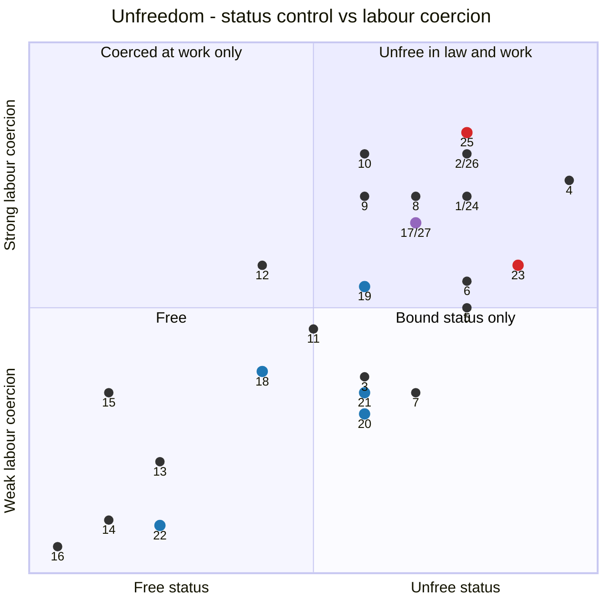

# [[ILO(International_Labour_Organization)]] 

#is_/same_as :: [[/_Standards/WikiData/WD~International_Labour_Organization,54129]] 

## #has_/text_of_/abstract 

> The International Labour Organization (ILO) is a United Nations (UN) agency 
> whose mandate is to advance social and economic justice by setting international labour standards. 
> 
> Founded in October 1919 under the League of Nations, 
> it is one of the first and oldest specialized agencies of the UN. 
> 
> The ILO has 187 member states: 186 out of 193 UN member states plus the Cook Islands. 
> 
> It is headquartered in Geneva, Switzerland, with around 40 field offices around the world, 
> and employs some 3,381 staff across 107 nations, 
> of whom 1,698 work in technical cooperation programmes and projects.
> 
> The ILO's standards are aimed at ensuring accessible, productive, and 
> sustainable work worldwide in conditions of freedom, equity, security and dignity. 
> 
> They are set forth in 193 conventions and treaties (as of 2026), 
> of which eight are classified as fundamental according to the 
> 1998 Declaration on Fundamental Principles and Rights at Work; together they protect 
> - freedom of association and 
> - the effective recognition of the right to collective bargaining, 
> - the elimination of forced or compulsory labour, 
> - the abolition of child labour, and 
> - the elimination of discrimination in respect of employment and occupation. 
> 
> The ILO is a major contributor to international labour law.
> 
> Within the UN system, the organization has a unique tri-partite structure: 
> all standards, policies, and programmes require discussion and approval from the representatives of governments, employers, and workers. This framework is maintained in the ILO's three main bodies: The International Labour Conference, which meets annually to formulate international labour standards; the Governing Body, which serves as the executive council and decides the agency's policy and budget; and the International Labour Office, the permanent secretariat that administers the organization and implements activities. The secretariat is led by the director-general, Gilbert Houngbo of Togo, who was elected by the Governing Body in 2022.
> 
> In 2019, the organization convened the Global Commission on the Future of Work, whose report made ten recommendations for governments to meet the challenges of the 21st century labour environment; these include a universal labour guarantee, social protection from birth to old age and an entitlement to lifelong learning. With its focus on international development, it is a member of the United Nations Development Group, a coalition of UN organizations aimed at helping meet the Sustainable Development Goals.
> 
> Two milestones in the history of the ILO were the Treaty of Versailles in 1919, establishing the International Labour Organization, Article 427. And secondly, the Declaration of Philadelphia in 1944, reestablishing the ILO under the UN and reaffirming the first principle that "labour is not a commodity".
>
> [Wikipedia](https://en.wikipedia.org/wiki/International%20Labour%20Organization)  

## Graded 

I scored each step against the 11 ILO indicators, using the 2025 revised edition of the booklet. It keeps the same 11 indicators as the 2012 edition. The markings are my own judgement of the typical case. The ILO doesn't publish scores.

**Scoring:** ● = typical or defining (2 points), ◐ = common but not defining (1), ○ = rare or absent (0), – = doesn't apply, for example documents in pre-modern settings (0). The maximum is 22.

## ILO indicators

- V vulnerability abuse, 
- D deception, 
- M movement restriction, 
- I isolation, 
- G physical and sexual violence, 
- T threats and intimidation, 
- P retention of identity documents, 
- W withholding of wages, 
- S debt bondage, 
- C conditions of working and living , 
- O overtime excessive 

|    Score | Step                                                                     |  V  |  D  |  M  |  I  |  G  |  T  |  P  |  W  |  S  |  C  |  O  |
| -------: | ------------------------------------------------------------------------ | :-: | :-: | :-: | :-: | :-: | :-: | :-: | :-: | :-: | :-: | :-: |
|  private | employment                                                               |     |     |     |     |     |     |     |     |     |     |     |
|       18 | Camp forced labour / *Lagerzwangsarbeit*                                 |  ●  |  ○  |  ●  |  ●  |  ●  |  ●  |  ●  |  ●  |  ○  |  ●  |  ●  |
|       18 | Indentured servitude / *Kontraktknechtschaft* (e.g. the "coolie" trade)  |  ●  |  ●  |  ●  |  ●  |  ◐  |  ◐  |  ◐  |  ◐  |  ●  |  ●  |  ●  |
|       17 | Chattel slavery / *Sklaverei*                                            |  ●  |  ◐  |  ●  |  ●  |  ●  |  ●  |  –  |  ●  |  ○  |  ●  |  ●  |
|       16 | Abduction / *Entführung*                                                 |  ◐  |  ◐  |  ●  |  ●  |  ●  |  ●  |  ◐  |  ●  |  ○  |  ●  |  ◐  |
|       16 | Debt bondage / *Schuldknechtschaft*                                      |  ●  |  ◐  |  ◐  |  ◐  |  ◐  |  ●  |  ○  |  ●  |  ●  |  ●  |  ●  |
|       16 | *Kafala*                                                                 |  ●  |  ●  |  ●  |  ◐  |  ◐  |  ◐  |  ●  |  ◐  |  ◐  |  ◐  |  ●  |
|       13 | Truck system / *Trucksystem*                                             |  ●  |  ◐  |  ◐  |  ●  |  ○  |  ◐  |  ○  |  ●  |  ●  |  ◐  |  ◐  |
|       12 | Serfdom / *Leibeigenschaft*                                              |  ●  |  ○  |  ●  |  ◐  |  ◐  |  ◐  |  –  |  ●  |  ◐  |  ◐  |  ◐  |
|       11 | Household slavery / *Haussklaverei*                                      |  ●  |  ○  |  ●  |  ◐  |  ◐  |  ●  |  –  |  ◐  |  ○  |  ◐  |  ◐  |
|       10 | Servants' law / *Gesindeordnung*                                         |  ◐  |  ○  |  ◐  |  ◐  |  ◐  |  ◐  |  ◐  |  ◐  |  ○  |  ◐  |  ●  |
|        8 | War captivity / *Kriegsgefangenschaft* (under Geneva III)                |  ◐  |  ○  |  ●  |  ●  |  ○  |  ◐  |  ◐  |  ○  |  ○  |  ◐  |  ○  |
|        7 | Bondage to the land / *Hörigkeit*                                        |  ◐  |  ○  |  ◐  |  ○  |  ○  |  ◐  |  –  |  ◐  |  ◐  |  ◐  |  ◐  |
|        7 | Precarity / *Prekarität*                                                 |  ◐  |  ◐  |  ○  |  ○  |  ○  |  ◐  |  ○  |  ◐  |  ○  |  ◐  |  ●  |
|        4 | Over-indebtedness / *Überschuldung*                                      |  ◐  |  ◐  |  ○  |  ○  |  ○  |  ◐  |  ○  |  ○  |  ○  |  ○  |  ◐  |
|        1 | Indebtedness / *Verschuldung*                                            |  ◐  |  ○  |  ○  |  ○  |  ○  |  ○  |  ○  |  ○  |  ○  |  ○  |  ○  |
|        0 | Standard employment / *Normalarbeitsverhältnis*                          |  ○  |  ○  |  ○  |  ○  |  ○  |  ○  |  ○  |  ○  |  ○  |  ○  |  ○  |
|   State- | imposed                                                                  |     |     |     |     |     |     |     |     |     |     |     |
|       15 | Prison labour for private firms, convict leasing (_Sträflingsverleih_)   |  ●  |  ○  |  ●  |  ●  |  ◐  |  ●  |  –  |  ●  |  ○  |  ●  |  ●  |
|       12 | Conscripts used for non-military work                                    |  ◐  |  ◐  |  ●  |  ◐  |  ◐  |  ●  |  ◐  |  ◐  |  ○  |  ◐  |  ◐  |
|        8 | State labour mobilisation for economic purposes (e.g. mass harvest duty) |  ◐  |  –  |  ◐  |  ○  |  ○  |  ●  |  –  |  ●  |  ○  |  ◐  |  ◐  |
|        6 | Conscription, purely military (permitted)                                |  ○  |  ○  |  ●  |  ◐  |  ○  |  ◐  |  ○  |  ○  |  ○  |  ◐  |  ◐  |
|        7 | Prison labour under public authority (permitted)                         |  ○  |  ○  |  ●  |  ●  |  ○  |  ◐  |  ○  |  ◐  |  ○  |  ◐  |  ○  |
|        1 | Civic duties: jury, emergency help (permitted)                           |  ○  |  ○  |  ○  |  ○  |  ○  |  ◐  |  ○  |  ○  |  ○  |  ○  |  ○  |
| Vestiges | of slavery                                                               |     |     |     |     |     |     |     |     |     |     |     |
|       19 | Child domestic servitude (e.g. Haiti's _restavèk_ system)                |  ●  |  ●  |  ●  |  ●  |  ●  |  ●  |  ◐  |  ●  |  ○  |  ●  |  ●  |
|       18 | Forced marriage with domestic servitude                                  |  ●  |  ◐  |  ●  |  ●  |  ●  |  ●  |  ◐  |  ●  |  ◐  |  ◐  |  ●  |
|       16 | Caste-based hereditary bonded labour (South Asia)                        |  ●  |  ◐  |  ◐  |  ◐  |  ◐  |  ●  |  ○  |  ●  |  ●  |  ●  |  ●  |
|       15 | Debt peonage (US South after 1865)                                       |  ●  |  ●  |  ◐  |  ◐  |  ◐  |  ●  |  –  |  ●  |  ●  |  ◐  |  ◐  |
|       13 | Descent-based slavery (Sahel)                                            |  ●  |  ○  |  ●  |  ◐  |  ◐  |  ●  |  –  |  ●  |  ○  |  ●  |  ◐  |

**What the new points show:**
- **Permitted and forbidden forced labour look alike on status and differ only in coercion.** 
  Conscription (20) and prison labour under public authority (21) score 6 on status, 
  the same as their misused forms (19, and 17 apart from exit). 
  What tips them into forced labour under ILO rules is 
  who benefits and what the work is: private firms or non-military work. 
  Neither axis captures that directly.
- **State mobilisation (18) sits near the truck system (12).** 
  The person stays legally free but faces sanctions such as losing their job or being expelled from university.
- **The vestiges of slavery mostly score as high as the historical forms.** 
  Child servitude (25) scores the highest on the ILO axis of all 27 steps. 
  Descent-based slavery (23) has the highest status score after chattel slavery, 
  because heritability survives the formal abolition.
- **Convict leasing (17) and debt peonage (27) share a point.** 
  Historically they were two halves of one system that **replaced slavery in the US South**.

**Caveats:**
- The booklet says deception, document retention and threats by employers often don't apply to state-imposed forms (marked –). Those forms therefore score lower on the ILO axis than their actual severity.
- Each vestige varies by region and case. I scored a typical case, and these markings are more uncertain than those for 1-16.
- In the image, the labels of 3 and 5 are partly hidden. The colour of 24 and 26 doesn't show because they share points with 1 and 2.

The image is at C:\Users\heuerm\AppData\Local\Temp\claude\7f1b9910492b6e8b\88827126-446d-412a-9a58-29d2413b4b19\scratchpad\unfreedom.png and the source at C:\Users\heuerm\AppData\Local\Temp\claude\7f1b9910492b6e8b\88827126-446d-412a-9a58-29d2413b4b19\scratchpad\unfreedom.mmd.

**What the re-ranking shows:**
- **The ILO indicators measure coercion in work, not legal status.** 
  Being someone's property and passing the status to one's children have no indicator. 
  So slavery and serfdom drop, and war captivity drops sharply, 
  because labour under Geneva III is paid and regulated. 
  To capture status-based unfreedom you would need my earlier criteria as a second axis: 
  legal status against labour coercion.
- **Deception and engineered debt weigh heavily.** 
  That is why indentured servitude, *Kafala* and the truck system move up. 
  Their unfreedom comes from the hiring and payment arrangements, not from the law.
- **Precarity now ranks above over-indebtedness.** 
  The indicator "debt bondage" only counts debt owed to the employer or recruiter, 
  so consumer debt isn't labour coercion. 
  Piece rates that force long hours, on the other hand, are named explicitly under "excessive overtime".

**Caveats from the booklet itself:**
- A single indicator doesn't prove forced labour. 
  Only a combination does, especially coercion together with the absence of free and informed consent.
- Indicators must be judged from the victim's point of view.
- The list is built for today's private employment. 
  Forms imposed by a state (camps, captivity) and "vestiges of slavery" need adapted indicators. 
  For the historical steps, that makes my markings an extrapolation.

Sources: [ILO indicators of forced labour, 2025 revised edition](https://www.ilo.org/publications/ilo-indicators-forced-labour-1) and the [2012 edition](https://www.ilo.org/publications/ilo-indicators-forced-labour).

## alternative Scoring

- B body (physical integrity, punishment), 
- M movement (where one may live or go), 
- L labour (whom one works for, on what terms), 
- E exit (a legal path out), 
- H heritable (status passes to children).

Four of these criteria are covered by ILO indicators. 
**Heritable** has almost no counterpart, and **abuse of vulnerability** has none on my side.

| ILO indicator                         | Body | Movement | Labour | Exit | Heritable |
| ------------------------------------- | ---- | -------- | ------ | ---- | --------- |
| Abuse of vulnerability                |      |          |        |      |           |
| Deception                             |      |          | ●      | ◐    |           |
| Restriction of movement               |      | ●        |        | ◐    |           |
| Isolation                             |      | ●        |        | ◐    |           |
| Physical and sexual violence          | ●    |          |        | ◐    |           |
| Intimidation and threats              | ◐    |          |        | ●    |           |
| Retention of identity documents       |      | ◐        |        | ●    |           |
| Withholding of wages                  |      |          | ●      | ●    |           |
| Debt bondage                          |      |          | ◐      | ●    | ◐         |
| Abusive working and living conditions | ◐    |          | ●      |      |           |
| Excessive overtime                    |      |          | ●      |      |           |

● = the indicator measures this criterion directly, ◐ = partly or as a side effect.

**Exit** has the most overlap, with eight indicators. That matches the ILO definition, whose core is the "freedom to leave the job". The booklet assesses wage withholding, threats and document retention by whether they are used to stop someone leaving.

**Labour** maps onto deception, wages, conditions and overtime. **Body** has only one direct match, violence; threats and conditions touch it partly. **Movement** matches restriction of movement and isolation.

**Heritable** is touched only by debt bondage, where the booklet mentions inherited debts. That gap is the reason slavery and serfdom fell in the ILO ranking.

**Abuse of vulnerability** describes the precondition for coercion, not a dimension of it, so none of my criteria corresponds to it. It would be a sixth criterion, "starting position".

So the two scales overlap in body, movement, labour and exit. Each also measures something the other doesn't: mine captures legal status passing to children, the ILO's captures deception and the victim's vulnerable starting position. A combined scale would have seven criteria: my five plus deception and vulnerability.
Added the state-imposed forms (17-22, blue) and the vestiges of slavery (23-27, red), using the categories from section 5 of the ILO booklet. Three pairs score identically and share a point, labelled 1/24, 2/26 and 17/27.

The plot inherits two weaknesses from the scoring. All markings are my judgement of the typical case, so each point could move one or two units. And the horizontal axis isn't purely legal status: abduction and the camp score high on it through physical control, not legal ownership.

## Budget 

All three organisations budget over multi-year periods, so the yearly figures below are averages. They also measure different things: the ILO figure is an approved spending budget, while the FIFA and IOC figures are commercial revenue, most of which they pass on to member associations, national committees and federations.

| Org                                                                           | Period                 | Total                                                                        | Per year (average)      | What the figure covers                                                                              |
| ----------------------------------------------------------------------------- | ---------------------- | ---------------------------------------------------------------------------- | ----------------------- | --------------------------------------------------------------------------------------------------- |
| [[ILO(International_Labour_Organization)\|ILO]]                               | 2026-27 (two years)    | US$ 930.5 million                                                            | about US$ 465 million   | Regular budget from member states' assessed contributions                                           |
| [[../../Sports_Organization/FIFA\|FIFA]]                                      | 2027-2030 (four years) | about US$ 14 billion projected revenue                                       | about US$ 3.5 billion   | Mainly **World Cup media rights**, sponsorship and tickets; 2025 actual revenue was US$ 2.6 billion |
| [[International_Sports_Federation/IOC(International_Olympic_Committee)\|IOC]] | 2021-2024 (four years) | US$ 7.7 billion commercial revenue, roughly US$ 12 billion in broader totals | about US$ 1.9-3 billion | Mainly **broadcasting rights and the TOP sponsorship programme**; 88% distributed onward            |

On a yearly basis, FIFA's budget is about seven times the ILO's regular budget, and the IOC's is four to six times as large.

Sources:
- [ILO Programme and Budget 2026-27](https://www.ilo.org/sites/default/files/2026-03/Programme%20and%20Budget%202026-27%20ENG_Web.pdf), [ILO decision on the 2026-27 financial position](https://www.ilo.org/resource/record-decisions/gb/gb356/decision-concerning-financial-position-ilo%E2%80%99s-regular-budget-2026%E2%80%9327-and), [BusinessWorld on the US arrears](https://www.bworldonline.com/world/2025/10/14/705349/ilo-could-face-job-losses-if-us-does-not-pay-dues)
- [Inside World Football: FIFA 2025 revenue and 2027-30 projection](https://www.insideworldfootball.com/2026/03/23/fifa-reports-2-6bn-revenue-2025-projects-14bn-2027-30-cycle/), [WAM: FIFA expects US$ 14 billion](https://www.wam.ae/en/article/bzzs4qf-fifa-anticipates-14-billion-revenue-for-2027-2030)
- [Sportcal: IOC financials](https://www.sportcal.com/news/ioc-highlights-strong-financials-ahead-of-presidential-election/), [The Sports Examiner: IOC annual report](https://www.thesportsexaminer.com/intl-olympic-committee-annual-report-shows-ioc-distributed-almost-74-of-its-revenues-from-2021-24-and-has-4-9-billion-in-the-bank/), [Philstar: IOC to distribute US$ 6.8 billion](https://philstar.com/sports/2024/12/04/2404956/olympic-body-distribute-68-billion-2021-24-cycle)

